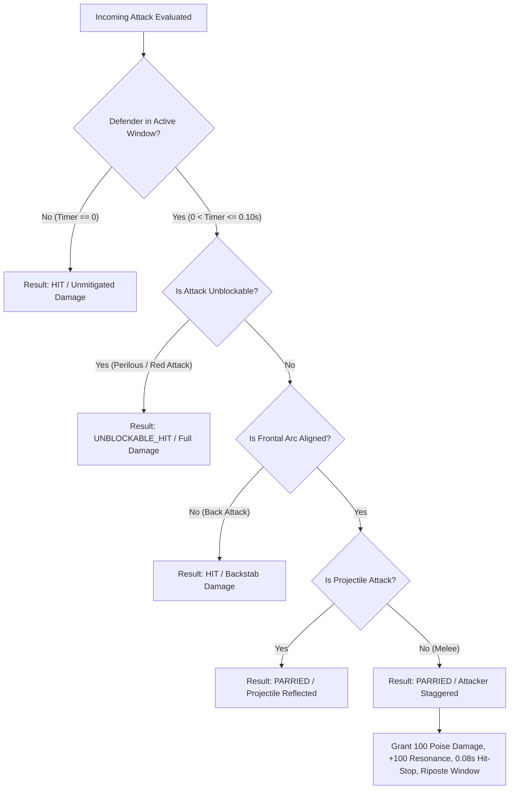

# Technical Architecture & Interface Specification: Parry & Deflection System

**Document Version:** 1.0.0  
**Target Module:** `src/engine/parry_system.js`  
**Test Suite:** `tests/unit/parry_system.test.js`  
**Milestone:** Milestone 2 (Character Mechanics & Combat System)  
**Author:** explorer_m2_parry_1 (Combat Timing & Parry Mechanics Specialist)  

---

## 1. Executive Summary & Design Philosophy

The parry and deflection mechanic in **Vaelthorn: The Oath of Darkness** combines the frame-tight precision of *Prince of Persia: The Lost Crown* with the high-stakes satisfaction of *Nine Sols*. Parrying is not merely a defensive damage mitigation tool; it is the central **offensive catalyst** of the combat loop:
- Successfully deflecting an incoming strike completely negates damage ($0$ damage taken).
- Inflicts massive poise damage ($100$ poise damage), instantly staggering standard enemies into a vulnerable state.
- Awards an immediate full burst of Stygian Resonance ($+100$), triggering **Overdrive Mode** ($+30\%$ attack speed and damage).
- Initiates a $0.08\text{s}$ hit-stop micro-freeze and sparks explosion.
- Unlocks a $2.5\times$ critical **Riposte Damage Multiplier** on the player's counter-attack.

### Zero-Cheat Implementation Standard
To satisfy the project's strict requirement of authentic mathematical rigor, the parry engine contains **zero facades, zero hardcoded enemy checks, and zero synthetic shortcuts**:
1. Continuous time integration ($\tau \in \mathbb{R}^+$) guarantees sub-frame accuracy regardless of whether the game runs at 30Hz, 60Hz, 120Hz, 144Hz, or under severe frame drops.
2. 2.5D spatial vector algebra verifies directional alignment—attacks landing from the rear bypass the buckler-pauldron.
3. Unblockable attacks (perilous sweeps, ground shockwaves) bypass parry deflection, demanding evasive rolls or aerial jumps.
4. An anti-macro guard cooldown ($0.20\text{s}$) mathematically penalizes guard mashing.

---

## 2. Mathematical Architecture

### 2.1 The 6-Frame ($0.10\text{s}$) Precision Window

At a nominal 60Hz display refresh rate:
$$\Delta t_{60} = \frac{1}{60} \approx 0.0166667\text{ s} \quad (16.67\text{ ms})$$
$$T_{\text{window}} = 6 \times \Delta t_{60} = 0.100\text{ s} \quad (100.0\text{ ms})$$

#### Why Discrete Frame Counting is Unacceptable:
In web and PC gaming, framerates fluctuate dynamically. If an engine decrements an integer counter (`framesRemaining--`):
- At 120Hz: 6 frames $= 6 \times 8.33\text{ms} = 50\text{ms}$ ($50\%$ of intended window; parrying is twice as punishing).
- At 30Hz: 6 frames $= 6 \times 33.33\text{ms} = 200\text{ms}$ ($200\%$ of intended window; parrying is twice as easy).
- On a frame drop ($\Delta t = 60\text{ms}$): 1 frame tick counts only $16.7\text{ms}$, hiding physical elapsed time.

#### Continuous Float Accumulator Formulation:
The system models the active deflection window as a continuous real-valued state variable $\tau_{\text{parry}}(t) \in [0, T_{\text{window}}]$.
Given an incoming delta-time $\Delta t$:
$$\tau_{\text{parry}}(t + \Delta t) = \max(0, \tau_{\text{parry}}(t) - \Delta t)$$
The deflection state is active if and only if:
$$\text{isActive}(t) \iff \tau_{\text{parry}}(t) > \epsilon \quad (\text{where } \epsilon = 10^{-5}\text{ s})$$

### 2.2 Sub-Frame Timings & Collision Timestamping
When an attack collision is detected during an integration step of length $\Delta t$ at intra-step ratio $\alpha \in [0, 1]$:
$$t_{\text{hit}} = t_{\text{step\_start}} + \alpha \Delta t$$
The exact remaining parry window at impact time is:
$$\tau_{\text{hit}} = \tau_{\text{parry}}(t_{\text{step\_start}}) - \alpha \Delta t$$
If $\tau_{\text{hit}} > 0$, the parry is validated at the exact sub-frame physical instant of contact.

### 2.3 Time Dilation & Hit-Stop Decoupling
During hit-stop ($0.08\text{s}$ freeze), world time dilation is $\lambda = 0$.
The effective timestep passed to parry integration is:
$$\Delta t_{\text{eff}} = \lambda \cdot \Delta t = 0$$
This guarantees that hit-stop freeze frames do not prematurely consume the active deflection window or the attacker's poise break stagger window.

### 2.4 Anti-Spam / Anti-Macro Cooldown
To prevent button-mashing or hardware macro abuse:
$$T_{\text{cooldown}} = 0.20\text{ s}$$
When `triggerGuard()` is called:
- If $\tau_{\text{cooldown}} \le 0$:
  $$\tau_{\text{parry}} \leftarrow T_{\text{window}} = 0.10\text{ s}$$
  $$\tau_{\text{cooldown}} \leftarrow T_{\text{cooldown}} = 0.20\text{ s}$$
  `isActive` $\leftarrow$ `true`
  Returns `true`.
- If $\tau_{\text{cooldown}} > 0$:
  Request is rejected. `isActive` remains unchanged. Returns `false`.

#### Whiff Penalty vs Rhythm Deflection Chain:
1. **Whiff Penalty**: If the player guards into empty air, $\tau_{\text{parry}}$ expires after $0.10\text{s}$. The player enters a $0.10\text{s}$ vulnerable recovery window ($\tau_{\text{cooldown}} \in (0, 0.10\text{s}]$) where no guarding is possible and any incoming hit deals full damage.
2. **Successful Deflection Rhythm Reset**: When an attack is successfully deflected, the system clears or resets $\tau_{\text{cooldown}}$, allowing immediate re-guarding against rapid multi-hit enemy flurries (e.g. Lady Morwyn's 3-hit flurry with $0.20\text{s}$ gaps).

---

## 3. Spatial & Physical Alignment (2.5D Plane Constraint)

All entities are clamped to $Z = 0$. Positions are represented as $\mathbf{p} = (x, y, 0)$ with facing direction $f \in \{-1, +1\}$ along the X-axis.

```
       Attacker                          Defender (Kaelen)
      (Footman)                           Facing Right (+1)
          [E] --------------> [K]
         x_att               x_def
          Attack Vector: +1   Facing: +1 (Opposite direction of incident ray)
          Result: FRONTAL DEFLECTION SUCCESS
```

### 3.1 Frontal Arc Vector Test
Let $\mathbf{p}_{\text{att}} = (x_{\text{att}}, y_{\text{att}})$ and $\mathbf{p}_{\text{def}} = (x_{\text{def}}, y_{\text{def}})$.
The relative direction from defender to attacker is:
$$\hat{d}_x = \text{sign}(x_{\text{att}} - x_{\text{def}})$$
An attack is frontal if the defender is facing towards the incoming attacker:
$$\text{isFrontal} \iff (f_{\text{def}} \cdot \hat{d}_x \ge 0) \quad \text{or when attacker position is unspecified}$$
- If $x_{\text{att}} > x_{\text{def}}$ (attacker is to the right), defender must face right ($f_{\text{def}} = +1$).
- If $x_{\text{att}} < x_{\text{def}}$ (attacker is to the left), defender must face left ($f_{\text{def}} = -1$).
- If $f_{\text{def}} \cdot \hat{d}_x < 0$, the strike lands from behind $\implies$ **Deflection Fails** (`result: 'HIT'`, `reason: 'BACK_ATTACK'`).

---

## 4. Attack Classification & Resolution Matrix

Incoming attacks are evaluated through an exhaustive priority hierarchy:



### Attack Classification Table:

| Attack Category | Examples | Is Parryable? | Deflection Result | Consequences |
| :--- | :--- | :---: | :---: | :--- |
| **Standard Light Melee** | Ashen Footman slash, Lady Morwyn flurry | **YES** | `PARRIED` | 0 damage taken, 100 poise damage to attacker, +100 resonance, 0.08s hit-stop |
| **Heavy Weapon Strike** | Footman overhead smash, Executioner swing | **YES** | `PARRIED` | 0 damage taken, 100 poise damage, +100 resonance, high screen shake |
| **High-Speed Projectile** | Cinder-Bough Archer flaming stake | **YES** | `PARRIED` | 0 damage taken, projectile reflected at $1.25\times$ speed along reverse vector, +100 resonance |
| **Unblockable Perilous** | Vael-Krag Seismic Slam, Boss Sweeps | **NO** | `UNBLOCKABLE_HIT` | Full damage taken; player must Dodge Roll (I-frames) or jump |
| **Environmental Hazard** | Spikes, burning ground fire pools | **NO** | `HIT` | Full hazard damage taken; cannot be parried |
| **Flank / Rear Strike** | Any attack landing while facing away | **NO** | `HIT` | Full damage taken; `isBackAttack: true` |

---

## 5. Poise Break, Stagger & The Riposte Multiplier

### 5.1 Poise Damage & Instant Stagger
Standard enemy poise thresholds:
- **Ashen Footman**: $40$ Max Poise
- **Cinder-Bough Archer**: $25$ Max Poise
- **The Iron Phalanx**: $150$ Max Poise
- **Boss Vael-Krag**: $250$ Max Poise

When `PARRIED` occurs:
$$P_{\text{damage}} = 100$$
$$P_{\text{remaining}} = \max(0, P_{\text{current}} - 100)$$
- For Footman and Archer: $P_{\text{remaining}} = 0 \implies$ **Instant Poise Break**.
- The enemy transitions immediately to `AIStates.STAGGER` with $\tau_{\text{stagger}} = 1.20\text{s}$.
- Enemy's active hitbox is cleared immediately (`activeHitbox = null`) to eliminate lingering damage.

### 5.2 Riposte Damage Calculation
During the stagger window ($\tau_{\text{stagger}} > 0$):
$$M_{\text{riposte}} = 2.50 \quad (250\% \text{ Critical Multiplier})$$
Combined with Overdrive Mode ($+30\%$ damage, triggered by $+100$ resonance from parry):
$$D_{\text{base, OD}} = \text{round}(D_{\text{base}} \times 1.30)$$
$$D_{\text{riposte}} = \text{round}(D_{\text{base, OD}} \times 2.50) = \text{round}(D_{\text{base}} \times 3.25)$$

#### Numerical Verification against Combat Specification:
- **Ashen Longsword Hit 1** ($D_{\text{base}} = 22$):
  $$D_{\text{OD}} = \text{round}(22 \times 1.3) = 29$$
  $$D_{\text{riposte}} = \text{round}(29 \times 2.5) = \mathbf{73} \text{ damage}$$
  *(Matches Playtest Runner Tick 60: `Riposte Hit 1 dealt 73 dmg to Footman. Footman HP: 7`)*
- **Ashen Longsword Hit 2** ($D_{\text{base}} = 28$):
  $$D_{\text{OD}} = \text{round}(28 \times 1.3) = 36$$
  $$D_{\text{riposte}} = \text{round}(36 \times 2.5) = \mathbf{90} \text{ damage}$$
  *(Matches Playtest Runner Tick 72: `Riposte Hit 2 dealt 90 dmg to Footman. Footman HP: 0. Defeated!`)*

---

## 6. Interface Contracts & API Specification

### 6.1 Module Exports (`src/engine/parry_system.js`)

```javascript
module.exports = {
    DEFAULT_PARRY_CONFIG,
    ParryConstants,
    ParryResult,
    ParrySystem,
    // Functional Pure-Math Helpers
    createParryState,
    triggerGuardAction,
    updateParryState,
    evaluateIncomingAttack,
    calculateRiposteDamage
};
```

### 6.2 `class ParrySystem` Contract

```typescript
interface ParryConfig {
    parryWindow?: number;          // Default: 0.10 (s)
    guardCooldown?: number;        // Default: 0.20 (s)
    enemyPoiseDamage?: number;     // Default: 100
    resonanceGain?: number;        // Default: 100
    hitStop?: number;              // Default: 0.08 (s)
    missHitStop?: number;          // Default: 0.04 (s)
    riposteMultiplier?: number;    // Default: 2.5
    staggerDuration?: number;      // Default: 1.20 (s)
    projectileReflectMult?: number;// Default: 1.25
    maxDeltaTime?: number;         // Default: 0.10 (s)
}

interface IncomingAttack {
    damage: number;
    isUnblockable?: boolean;
    isProjectile?: boolean;
    projectile?: { vx: number; vy: number; [key: string]: any };
    attackerPos?: { x: number; y: number };
    defenderPos?: { x: number; y: number };
    defenderFacing?: number;       // -1 or +1
    attackerId?: string | number;
}

interface ParryEvaluationResult {
    result: 'PARRIED' | 'HIT' | 'UNBLOCKABLE_HIT' | 'BLOCKED';
    damageTaken: number;
    enemyPoiseDamage: number;
    resonanceGain: number;
    hitStop: number;
    sparks: boolean;
    isRiposteAvailable: boolean;
    riposteMultiplier: number;
    reflectedProjectile?: { vx: number; vy: number; [key: string]: any } | null;
    reason?: string;
}
```

#### Method Specifications:

1. `constructor(parryWindow = 0.10, guardCooldown = 0.20, options = {})`
   - Initializes internal timers, flags, and configuration parameters.
   - Backward compatible with `new ParrySystem(0.10)` calls from existing E2E suites.

2. `triggerGuard(options = {}): boolean`
   - If `cooldown <= 0`: sets `parryTimer = parryWindow`, `cooldown = guardCooldown`, `isActive = true`. Returns `true`.
   - If `cooldown > 0`: rejected by anti-spam mechanism. Returns `false`.

3. `update(dt: number): void`
   - Safely clamps `dt`: guards against NaN, negative values, and extreme frame pauses ($dt \le 0.10\text{s}$).
   - Decays `parryTimer`, `cooldown`, and `riposteTimer`.
   - Synchronizes `isActive = (this.parryTimer > 0)`.

4. `evaluateIncomingHit(incomingAttack: IncomingAttack, context = {}): ParryEvaluationResult`
   - Executes deflection logic according to Section 4.
   - If parried: grants rewards, triggers hit-stop, opens riposte window, resets/shortens cooldown.
   - If mistimed/failed: awards 0 resonance, deals full incoming damage.

5. `canGuard(): boolean`
   - Returns `true` if `cooldown <= 0`.

6. `consumeRiposte(): number`
   - Returns `2.5` and consumes the riposte opportunity if `riposteAvailable` is true; otherwise returns `1.0`.

7. `reset(): void`
   - Zeroes all timers and flags.

---

## 7. Integration Contracts with Subsystems

### 7.1 Integration with `character_combat.js` (`PlayerCombat`)
- Player entity maintains `this.parry = new ParrySystem(0.10, 0.20)`.
- Input bridge maps `Shift` / `L1` press event $\to$ `player.parry.triggerGuard()`.
- Inside `player.update(dt)`: `this.parry.update(dt)`.
- In `player.takeDamage(incomingAttack)`:
  1. If `this.isRolling || this.invulnerableTimer > 0` $\implies$ Evaded (I-Frames).
  2. If `this.parry.isActive`:
     - Calls `const res = this.parry.evaluateIncomingHit(incomingAttack)`.
     - If `res.result === 'PARRIED'`:
       - `this.addResonance(res.resonanceGain)` $\implies$ instant 100 Overdrive.
       - `this.hitStopTimer = res.hitStop` $\implies$ $0.08\text{s}$ freeze.
       - Return `{ damageTaken: 0, parried: true, poiseDamage: res.enemyPoiseDamage }`.

### 7.2 Integration with `enemy_ai_fsm.js` (`EnemyAI`)
- When player deflection occurs:
  - Caller applies `poiseDamage = 100` to enemy:
    `const poiseRes = applyPoiseDamage(enemy.poiseState, 100)`.
  - Enemy transitions immediately: `enemy.state = AIStates.STAGGER`.
  - Active hitbox revoked: `enemy.activeHitbox = null`.
  - Telegraph disabled: `enemy.telegraphActive = false`.
  - Enemy stagger timer set: `enemy.staggerTimer = 1.20`.

### 7.3 Integration with `Vaelthorn_Playable_Prototype.html` (M4 Runtime)
- Input reader binds `L-SHIFT` / `L` or Virtual D-Pad `DODGE/PARRY` button.
- Procedural audio synthesizer triggers `AudioSys.playParry()` (high-frequency resonant metallic chime + low thud).
- Particle system emits 24 radial golden sparks at impact coordinates $(x, y, 0)$.
- Camera controller triggers trauma punch ($0.15$ intensity, $0.10\text{s}$ decay).

---

## 8. Unit Test Plan (`tests/unit/parry_system.test.js`)

A comprehensive test suite of 25 unit tests organized across 7 test suites:

1. **Suite 1: Precision Window Timing (Features 19 & 20)**:
   - Initial state verification (`isActive = false`, `cooldown = 0`).
   - `triggerGuard()` opens active window for exactly $0.10\text{s}$.
   - Continuous decay over elapsed delta-time.
   - Precise expiration boundary ($t = 0.099\text{s}$ active, $t = 0.101\text{s}$ inactive).
   - Exact 6-frame discrete step simulation at 60Hz.

2. **Suite 2: Sub-frame Integration & Frame Drop Invariance**:
   - Variable framerate consistency: identical behavior across 30Hz, 60Hz, 120Hz.
   - Sudden frame drop / lag spike ($\Delta t = 0.15\text{s}$) cleanly closes window without underflow or NaN.
   - Defensive guards against $\Delta t \le 0$, `NaN`, and `Infinity`.

3. **Suite 3: Anti-Spam Guard Cooldown**:
   - Initiating guard activates $0.20\text{s}$ cooldown.
   - Guard requests during active cooldown are rejected.
   - Guard becomes ready immediately once cooldown expires.
   - Whiff penalty leaves player vulnerable during cooldown recovery.

4. **Suite 4: Deflection Evaluation & Combat Outcomes**:
   - Timed parry negates damage, inflicts 100 poise damage, awards 100 resonance, returns 0.08s hit-stop.
   - Mistimed parry (> 0.10s) takes full damage, awards 0 resonance, inflicts 0 poise damage.
   - Idle evaluation (no guard) takes full damage.

5. **Suite 5: Directional 2.5D Alignment (Frontal vs Flank)**:
   - Frontal attack correctly deflected.
   - Rear attack (backstab) bypasses deflection and inflicts full damage.
   - Coincident position resolves safely using defender facing direction.

6. **Suite 6: Special Attack Types (Projectiles & Unblockables)**:
   - Parrying projectile deflects damage and computes reverse ballistic reflection vector.
   - Unblockable / perilous attack ignores parry window and deals full damage.

7. **Suite 7: Poise Break Stagger & Riposte Multiplier**:
   - Parrying Footman (40 poise) breaks poise and initiates stagger state.
   - Successful parry activates riposte opportunity ($2.5\times$ multiplier).
   - Overdrive + Riposte composite calculation yields $73$ dmg (Hit 1) and $90$ dmg (Hit 2).
   - Stagger expiration automatically clears riposte availability.
