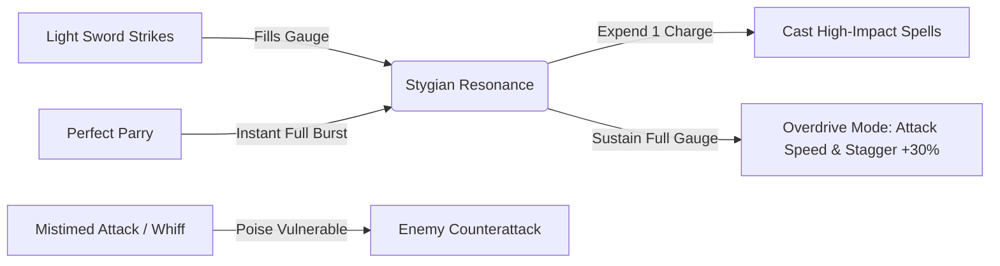

# GAME DESIGN DOCUMENT: VAELTHORN — THE OATH OF DARKNESS
**Project Codename:** Vaelthorn  
**Genre:** 2.5D Dark Fantasy Action-Adventure RPG / Metroidvania  
**Target Platforms:** Windows PC & Android  
**Engine:** Unity (Universal Render Pipeline - URP)  
**Target Experience:** 10+ Hours of Combat, Exploration & Progression  
**Design Philosophy:** "Gameplay First, Atmospheric Lore, Crisp 60fps Combat Feel"

---

## 1. TITLE SELECTION & BRAND IDENTITY

### Option A (Recommended): *VAELTHORN: The Oath of Darkness*
- **Tone:** Heavy, gothic, resonant, and memorable. 
- **Commercial Appeal:** Evokes ancient curses, medieval knightly honor, and dangerous power. Perfect fit for store banners, logos, and app store search terms.

### Option B: *VAELTHORN: Ashen Covenants*
- **Tone:** Mystical, arcane, and lore-focused. Emphasizes dark pacts and residual magic.

### Option C: *ECLIPSE OF VAEL: The Stygian Blade*
- **Tone:** Action-driven and immediate. Centers focus on the legendary weapon and celestial catastrophe.

> [!NOTE]
> Throughout this document, we will adopt the title **VAELTHORN: The Oath of Darkness**.

---

## 2. WORLD & SETTING: THE SHATTERED REALM OF ELDERVAEL

```
                   [ The Shattered Heavens: The Bleeding Eclipse ]
                                          |
                                          v
+-----------------------------------------------------------------------------------+
|                           THE SHATTERED SOVEREIGNTY                               |
|                                                                                   |
|  [Haven of the Lost Vigil] <==== Safe Road ====> [Bleeding Courtyards of Morbryn] |
|        (Hub Sanctuary)                                (Introductory Region)       |
|               |                                                 |                 |
|               +-------------> [The Weeping Briarwood] <---------+                 |
|               |              (Overgrown Cursed Forest)                            |
|               v                                                                   |
|      [Sunken Necropolis] ====> [Cinder Crags] ====> [The Obsidian Citadel]        |
|      (Traps & Secrets)        (Platforming & Ash)      (High-Tier Endgame)        |
+-----------------------------------------------------------------------------------+
```

### The Premise
A thousand years ago, the High Kings of Eldervael averted extinction by sealing the **Stygian Flame** beneath the earth through a blood pact—the *First Oath*. The realm prospered in perpetual twilight, fueled by embers that never cooled. 

Inevitably, the celestial crown shattered in an event known as **The Bleeding Eclipse**. The dormant flame surfaced not as warmth, but as an encroaching black ash that petrified stone, twisted knights into mindless **Grave-Bound husks**, and covered the kingdoms in briars that weep indigo sap.

### Atmosphere & Environmental Themes
- **Color Palette:** Cold blackened steel, slate blues, bruised purples, and bone ash, punctuated by sharp incandescent lights: starlight-blue blade trails, molten violet magic, and warm amber safe-havens.
- **Architectural Motifs:** Monumental European gothic cathedrals, crumbling fortress ramparts, petrified titan bones, and overgrown subterranean crypts.
- **Environmental Storytelling:** No 10-minute dialogue cutscenes. The narrative unfolds through visual remnants—petrified soldiers caught mid-defense, banners torn by spectral beasts, and cryptic runic inscriptions carved into weapons.

---

## 3. MAIN CHARACTER: KAELEN, THE ECLIPSE-BOUND

```
                           [ Crested Visor - Starlight Blue Visor Slit ]
                                                |
              [ Asymmetrical Spiked Pauldron ]  |  [ Sleek Weapon Pauldron ]
                             \                  |                  /
                              +-----------------+-----------------+
                              |   Ebon-Steel Etched Plate Breast  |
                              |   with Faint Luminescent Runes    |
                              +-----------------+-----------------+
                                      |                   |
                     [ The Runic Gauntlet ]               | [ Ashen Longsword 'Penumbra' ]
                     (Catalyst for Spells)                | (Physical Steel)
                                      |                   |
                              +-----------------+-----------------+
                              |   Tattered Slate Cloak (Physics)  |
                              +-----------------+-----------------+
                                       /                 \
                          [ Plated Sabatons for Heavy Landings ]
```

### Identity & Silhouette
- **Name:** Kaelen, The Eclipse-Bound (The Last Knight of the Cinder Watch).
- **Visual Identity:**
  - **Armor:** Interlocking blackened steel plates etched with cracked silver runes. Asymmetrical design: the left shoulder bears a reinforced buckler-pauldron for parrying, while the right arm is lighter for fluid swordplay.
  - **The Visor:** A closed medieval sallet-style helmet with a razor-thin horizontal visor. Inside glows a steady, piercing **Starlight Blue** light.
    > [!IMPORTANT]
    > In 2.5D games, character readability is paramount. The glowing visor and trailing cloak guarantee the player never loses their knight during high-speed combat against dark backgrounds.
  - **The Billowing Cloak:** A tattered, ash-grey cloak that flows dynamically with player physics, accentuating dashes, rolls, and double-jumps.
  - **The Left Arm (Runic Gauntlet):** A jagged gauntlet wrapped in enchanted chains. It absorbs enemy essence and serves as the conduit for all magical casting.

---

## 4. COMBAT IDENTITY: THE "RESONANCE & SEVER" SYSTEM

The combat combines the **frame-tight responsiveness** of *Prince of Persia: The Lost Crown* with the **deliberate weight and parry satisfaction** of *Nine Sols*.



### Core Mechanics & Feel

| Mechanic | Input | Function | Game-Feel Element |
| :--- | :--- | :--- | :--- |
| **Light Combo** | Tap Attack ($1-3\times$) | Fast horizontal sweeps into an overhead cleave | 0.04s hit-stop on 3rd hit, subtle blue arc trail |
| **Heavy Cleave** | Hold Attack (0.5s) | High-poise strike that shatters enemy shields | Camera micro-punch (2% zoom-in), ground dust burst |
| **Parry / Deflect** | Timed Guard (Tap L1 / Shift) | Deflects incoming attack within a 6-frame window | **0.08s freeze-frame (Hit-Stop)**, sparks explosion, enemy poise break |
| **Shadow Roll** | Dash (R1 / Space) | Invincibility-frame (I-frame) roll through attacks | Motion blur trail, cloak sweeps low |
| **Aerial Plunge** | Down + Attack (Mid-air) | Drives sword downward into the ground | High impact screen shake, area shockwave |

### The Game-Feel Rulebook
1. **Hit-Stop (Micro-Freezes):** Every heavy attack or parry freezes both attacker and target for 3–5 frames ($0.05 - 0.08$ seconds). This creates tactile impact without slowing down real-time gameplay.
2. **Input Buffering:** Inputs are queued up to 0.15s in advance. If the player taps jump while finishing a sword swing, the jump triggers on the exact frame the recovery ends—no eaten inputs.
3. **Controlled Camera Shake:** Camera vibration decays exponentially over 0.2s and only occurs on critical hits, parries, and boss slams.

---

## 5. WEAPON & MAGIC ARSENAL

### Weapons (Swappable via D-Pad / Hotkey)

```
+---------------------------------------------------------------------------------+
| WEAPONS                                                                         |
+---------------------------------------------------------------------------------+
| 1. Ashen Longsword ("Penumbra")                                                 |
|    - Balanced speed, reach, and combo versatility.                              |
|    - Special: Dash-thrust piercing through light enemies.                       |
|                                                                                 |
| 2. Executioner's Great-Mace ("Earth-Shaker")                                    |
|    - Slow wind-up with Hyper-Armor (uninterruptible by light hits).              |
|    - Special: Destroys cracked stone walls and floors to reveal secret rooms.   |
|                                                                                 |
| 3. Twin Eclipse Daggers ("Fang & Talon")                                        |
|    - Blistering attack speed, rapid resonance generation.                       |
|    - Special: Flurry vault behind the enemy to strike their weak back.          |
+---------------------------------------------------------------------------------+
```

### Magic Spells (Consumes Resonance or Mana)
1. **Stygian Lance (Ranged Railgun):**
   - *Behavior:* Kaelen points his gauntlet forward, releasing a high-velocity beam of condensed starlight that pierces all enemies in a horizontal line across the 2D plane.
   - *Utility:* Snipes ranged snipers stationed on high platforms.
2. **Cinder Nova (Area Burst):**
   - *Behavior:* Kaelen slams his gauntlet onto the ground, erupting a ring of black fire 360 degrees around him.
   - *Utility:* Clears swarms of crawlers and burns away cursed purple briars blocking paths.
3. **Aegis of Umbra (Absorb & Riposte):**
   - *Behavior:* Surrounds the knight with a floating runic shield for 4 seconds. The next hit taken is completely neutralized and converts into 50% health recovery.

---

## 6. ENEMY ECOSYSTEM (5 PROTOTYPE ARCHETYPES)

```
[ Wisp of the Hollow Crown ] (Air Disruptor)
           ~
          (o)  ---> Homing projectiles & suicide explosion
           ~
-------------------------------------------------------------------------
[ Grave-Weaver Crawler ]        [ The Ashen Footman ]       [ The Iron Phalanx ]
  - Skitters on walls             - 2-hit sword combo         - Giant tower shield
  - Ambush drop attacks           - Teaches basic parry       - Requires jump-over or mace
                                                              
[ Cinder-Bough Archer ] (Ranged Sniper)
  - Fires parabolic flaming stakes from elevated ledges
```

1. **The Ashen Footman (Grunt):**
   - *Role:* Basic melee pacing enemy.
   - *Behavior:* Wanders along platforms. When alerted, runs toward the knight and performs a telegraphed 2-hit slash with a distinct white sword glint telegraph.
2. **Grave-Weaver Crawler (Ambusher):**
   - *Role:* Fast wall/ceiling menace.
   - *Behavior:* Clings to ceilings until Kaelen passes underneath, drops down for an ambush claw flurry, and jumps backward if hit.
3. **Cinder-Bough Archer (Ledge Harasser):**
   - *Role:* Ranged platform controller.
   - *Behavior:* Stations on high ledges. Fires piercing flaming wooden stakes in arcs. If Kaelen closes in, kicks with a wooden peg leg and rolls away.
4. **The Iron Phalanx (Heavy Juggernaut):**
   - *Role:* Skill-check obstacle.
   - *Behavior:* Holds an impenetrable tower shield. Frontal light attacks bounce off with heavy sparks. Must be defeated by parrying his slow overhead hammer smash, jumping behind him, or shattering his guard with the Heavy Great-Mace.
5. **Wisp of the Hollow Crown (Flying Support):**
   - *Role:* Aerial disruptor.
   - *Behavior:* Hovers out of melee reach, casting slow homing violet orbs. Requires the *Stygian Lance* spell or jump-attacks to swat out of the sky. Explodes upon defeat.

---

## 7. THREE MEMORABLE BOSS ENCOUNTERS

### Boss 1: Vael-Krag, The Weeping Gatekeeper (The Prologue Titan)
- **Arena:** The Rain-Drenched Grand Portcullis at the entrance to the fortress.
- **Visuals:** An 8-foot-tall fallen knight fused into rusted iron armor, dragging a massive church bell as a club.
- **Phase 1 (100% - 50% HP):**
  - *Bell Sweep:* Wide horizontal arc.
  - *Seismic Slam:* Slams bell into the paving stones; a shockwave ripples across the floor (forces player to jump).
- **Phase 2 (50% - 0% HP):**
  - Vael-Krag cracks the bell open, igniting it in violet stygian fire. His slams now leave burning ground pools that limit safe floor space. He leaps across the arena, demanding clean dash-rolls through his landings.

### Boss 2: Lady Morwyn, The Thorn of Sorrows (Agile / Duellist)
- **Arena:** The Sunken Arboretum, filled with petrified rose statues.
- **Visuals:** A blindfolded, graceful fencer wrapped in briar thorns, wielding twin needle-estocs.
- **Mechanics:** 
  - Extremely fast rhythm combat. She teleports through shadow petals, testing the player's parry timing on a 3-strike musical flurry.
  - At low health, she summons rooted thorn walls that close in, shrinking the 2D combat arena and heightening the tension.

### Boss 3: Malakor, The Eclipse Wyrm-Knight (Cinematic Spectacle)
- **Arena:** The Pinnacle of the Ashen Cathedral overlooking the bleeding moon.
- **Visuals:** A towering dragoon knight whose cape unfolds into crystalline draconic shadow wings.
- **Mechanics:** 
  - Seamlessly blends ground combat with aerial sweeps.
  - Takes flight and blankets half the screen in dark fire breath, requiring the player to use newly acquired traversal abilities (e.g., Wall Jump / Air Dash) to latch onto high cathedral spires to avoid the floor hazard.

---

## 8. HUB VILLAGE & FIRST EXPLORABLE REGION

### The Hub: *Haven of the Lost Vigil*
- **Location:** A sheltered sanctuary carved into the hollow ribcage of a petrified ancient colossus, perched over a misty cliff.
- **Atmosphere:** A warm sanctuary. Golden torchlight and soft lute acoustics contrast sharply with the grim, rainy world outside.
- **Key Inhabitants:**
  - **Ogrim, The Blind Blacksmith:** Uses collected *Cinder Ore* to sharpen weapons, expand combo strings, and socket runic gems.
  - **Sybilla, Keeper of the Hearth:** Deciphers memory fragments, refines the healing flask capacity, and gives cryptic lore directions.
  - **Kiran, The Wandering Scavenger:** Sells maps, consumable anti-toxins, and cosmetic armor dyes.

### Region 1: *The Bleeding Courtyards of Morbryn*
- **Layout Structure:**
  - **Entrance (Surface):** Broad castle battlements in torrential rain. Introduces movement, single jumps, and Ashen Footmen.
  - **Mid-Tier (Ramparts & Towers):** Broken stone staircases, vertical platforming with Cinder-Bough Archers on turrets.
  - **Lower Tier (Subterranean Wine Cellars):** Dimly lit chambers overgrown with glowing briars. Introduces crawlers and the first cracked wall hiding a secret Health Gem.
  - **The Grand Gate:** The boss arena for *Vael-Krag*. Unlocks the iron gate leading deeper into the kingdom.

---

## 9. 2.5D VISUAL DIRECTION & TECHNICAL ART PIPELINE

```
CAMERA VIEWPORT: 2.5D DEPTH LAYERS

[ Foreground: Z = -2 to -4 ]   -> Silhouetted stone arches, raindrops, out-of-focus cobwebs
-----------------------------------------------------------------------------------------
[ GAMEPLAY PLANE: Z = 0 ]      -> The Knight, Enemies, Platforms, Interactive Switches
                                  (Crisp lighting, rim-lit edges, 100% readable)
-----------------------------------------------------------------------------------------
[ Midground: Z = +4 to +8 ]    -> Cathedral walls, torch sconces, shattered stained glass
-----------------------------------------------------------------------------------------
[ Background: Z = +15 to +40 ] -> Distant ruined spires, mountain silhouettes, bleeding eclipse
```

### Camera Staging & Rules
- **Camera Type:** 3D Perspective Camera constrained to a 2D movement plane ($X, Y$).
- **Focal Length:** 45mm equivalent (natural depth compression without fish-eye distortion).
- **Pitch Angle:** Tilted downwards by $4^\circ - 6^\circ$ to reveal the floor plane and ground textures, adding physical depth to 2D jumps.
- **Cinematic Dynamic Framing:**
  - *Normal Traversal:* Medium framing keeping the knight centered with forward-look anticipation (camera leads in the direction of movement).
  - *Boss Battles:* Camera gently dollies back to expand the arena view and frame both combatants.

### Lighting & Materials (URP)
- **PBR Metallic/Roughness Workflow:** Armor behaves like real battered metal, reflecting wet highlights from torches and lightning strikes.
- **Character Separation Rim Lights:** Every character and enemy model receives an invisible directional backlight (Rim Light) that outlines their silhouette, ensuring they never blend into dark environments.

---

## 10. REALISTIC BEGINNER-FRIENDLY ROADMAP (AI-ASSISTED)

```
[ Phase 1: GDD & Vision ] ===> APPROVED (Current Step)
         |
         v
[ Phase 2: Project Scaffold & Greybox Sandbox ]
  - Create clean Unity project in E:\Vaelthorn
  - Install Universal Render Pipeline (URP) + New Input System
  - Setup 2.5D Camera Follow & 3D Character Controller
         |
         v
[ Phase 3: The Combat Core (Graybox Prototype) ]
  - Implement 3-hit light combo & jump attack using geometric blockouts
  - Hitbox / Hurtbox system + Damage script
  - One test dummy enemy with health & stagger
  - Hit-stop, screen shake, and damage numbers
         |
         v
[ Phase 4: Asset Integration & Visual Polish ]
  - Import 3D Knight model, animations, and weapon trails
  - Add audio effects and particle impacts
         |
         v
[ Phase 5: Vertical Slice Level (The Courtyard) ]
  - Build playable 10-minute slice with 3 enemy types & Gatekeeper Boss
         |
         v
[ Phase 6: Cross-Platform Controls & Optimization (PC + Android) ]
  - Keyboard/Mouse + Controller + Virtual On-Screen Touch Joystick
```

> [!TIP]
> **The Golden Rule for Beginners:** We never write code for a system until the previous system is verified working in play mode. No sprawling half-finished scripts. Each component is modular, readable, and commented.
