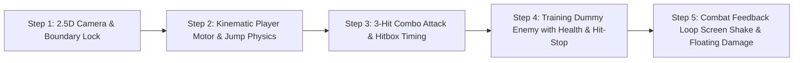

# TECHNICAL ARCHITECTURE PLAN: VAELTHORN — THE OATH OF DARKNESS
**Phase:** 2 — Technical Planning & System Architecture  
**Target Engine:** Unity 2022.3 LTS or Unity 6 (URP)  
**Project Path:** `E:\Vaelthorn`  
**Primary Language:** C# (.NET Standard / Unity Core)  
**Platform Targets:** Windows PC (x86_64) & Android (ARM64)

---

## 1. ENGINE SELECTION & GRAPHICS PIPELINE

```
+--------------------------------------------------------------------------------+
|                         UNITY UNIVERSAL RENDER PIPELINE (URP)                  |
+--------------------------------------------------------------------------------+
|  PC Pipeline Settings:                                                         |
|  - Full PBR (Physically Based Rendering) Metallic/Roughness materials           |
|  - Real-Time Directional Shadow Maps (2048 res) + Ambient Occlusion (SSAO)     |
|  - Post-Processing: ACES Tonemapping, Subtle Bloom, Chromatic Aberration       |
|                                                                                |
|  Android Scaled Pipeline Settings:                                             |
|  - Scaled Shadow Resolution (1024 res), Single-Pass Forward+ Rendering         |
|  - ASTC Texture Compression (high visual fidelity at 1/4th RAM usage)          |
|  - Dynamic Resolution Scaling targeting stable 60 FPS without thermal throttle |
+--------------------------------------------------------------------------------+
```

### Why Unity with URP? (In Plain English)
1. **Single Codebase for PC and Android:** We write our game logic once in C#. When we want to test on Windows, we press Play in the editor. When we want an Android build, Unity compiles the exact same code into an Android APK.
2. **Universal Render Pipeline (URP):** URP is Unity’s modern, highly optimized rendering engine. It gives us dark gothic lighting, volumetric fog, glowing runes, and metallic armor reflections, while running smoothly on mobile hardware without draining battery or causing thermal throttling.

---

## 2. MODULAR PROJECT ARCHITECTURE

In amateur game development, beginners often write a single giant `Player.cs` script with 3,000 lines handling movement, combat, sound, health, inventory, and input. When one line breaks, the whole game crashes.

At **VAELTHORN Studios**, we use a **Modular Component Architecture**. Each script has **one clear responsibility**:

```mermaid
flowchart TD
    subgraph InputLayer["Input Layer (Hardware Agnostic)"]
        A[Input Actions / Hardware] -->|Reads| B[InputReader.cs]
    end

    subgraph PlayerSystems["Player Character (Ebon Knight)"]
        B -->|Events: Move, Jump| C[PlayerMotor.cs]
        B -->|Events: LightAttack, HeavyAttack| D[PlayerCombat.cs]
        B -->|Events: CastSpell| E[PlayerMagic.cs]
        
        C -->|Translates Physics| F[CharacterController / Rigidbody]
        D -->|Triggers Hitboxes| G[DamageDealer.cs]
        
        H[Health.cs] -->|Reports Damage Taken| I[PlayerAudio & Feedback]
    end

    subgraph WorldCombat["Combat Collision & Interactions"]
        G -->|Sends Damage & Knockback| J[DamageReceiver.cs / Hurtbox]
        J -->|Updates| K[EnemyHealth.cs]
    end

    subgraph CameraSystem["2.5D Camera Controller"]
        C -.->|Tracks Player Position (X, Y)| L[CameraFollow2D5.cs]
        D -.->|Triggers Screen Shake| L
    end
```

### Breakdown of Core Scripts

| Script Name | Responsibility | What It Does (Plain English) |
| :--- | :--- | :--- |
| `InputReader.cs` | Controller Bridge | Translates keyboard keys, gamepads, and Android screen taps into generic commands ("Attack", "Jump", "Move"). |
| `PlayerMotor.cs` | Movement Physics | Moves the knight left/right along the 2D plane ($Z=0$), calculates gravity, checks if touching the ground, and performs jumps/rolls. |
| `PlayerCombat.cs` | Combo & Parries | Tracks combo timing (Attack 1 $\to$ Attack 2 $\to$ Attack 3), manages recovery frames, and checks parry windows. |
| `PlayerMagic.cs` | Energy & Spells | Manages the *Stygian Resonance* gauge and handles spawning projectile spells like *Stygian Lance*. |
| `Health.cs` | Universal Health | Reusable script attached to the player, enemies, and breakable crates. Tracks current HP, invulnerability frames, and triggers death. |
| `DamageDealer.cs` | The Sword's Edge | Attached to the sword's 3D trigger collider. Activates only during active swing frames to detect collisions with enemies. |
| `DamageReceiver.cs` | The Body Hurtbox | Attached to character bodies. Receives incoming hits, computes armor reduction, and passes damage to `Health.cs`. |
| `CameraFollow2D5.cs` | Cinematic Eye | Follows the player smoothly along $X$ and $Y$ while keeping $Z$ locked at $-12$. Adds subtle look-ahead and hit-shake. |

---

## 3. UNIFIED CROSS-PLATFORM INPUT STRATEGY

We will use Unity’s modern **New Input System** (`com.unity.inputsystem`). 

```
               +-------------------------------------------+
               |               Input Actions               |
               | (Move [Vector2], Attack, Jump, Roll, Cast)|
               +-------------------------------------------+
                                     ^
                                     |
               +---------------------+---------------------+
               |                                           |
       [ PC Input Binding ]                       [ Android Binding ]
   - Move: WASD / Arrow Keys                   - On-screen Virtual Joystick
   - Attack: Left Mouse Button / J             - Touch Button (Attack Icon)
   - Jump: Spacebar / K                        - Touch Button (Jump Icon)
   - Roll: Left Shift / L                      - Touch Button (Roll Icon)
   - Cast: Right Mouse Button / U              - Touch Button (Spell Icon)
```

> [!NOTE]
> Because gameplay scripts only listen to events from `InputReader.cs`, our player controller has zero platform-specific code. Everything works identically in the editor, on Windows, and on mobile.

---

## 4. STUDIO DIRECTORY STRUCTURE

The project is structured according to professional studio standards inside `E:\Vaelthorn`:

```
E:\Vaelthorn\
├── Docs\                                 <- Design documents, art guides, technical specs
│   ├── GDD_Vaelthorn.md
│   └── Technical_Plan_Vaelthorn.md
├── Assets\
│   └── _Project\                         <- All custom game assets live here (never mixed with third-party assets)
│       ├── Scripts\
│       │   ├── Core\                     <- GameManager, InputReader, Enums
│       │   ├── Player\                   <- PlayerMotor, PlayerCombat, PlayerMagic
│       │   ├── Combat\                   <- Health, DamageDealer, DamageReceiver, Hitbox
│       │   ├── Enemies\                  <- EnemyAI, BossStateMachine
│       │   ├── Camera\                   <- CameraFollow2D5, ScreenShake
│       │   └── UI\                       <- HealthBarHUD, MobileVirtualControls
│       ├── Prefabs\                      <- Saved ready-to-use game objects (Player, Enemies, Spells)
│       ├── Materials\                    <- PBR dark fantasy shaders & textures
│       ├── Animations\                   <- Animator controllers, blend trees, attack clips
│       └── Scenes\
│           ├── Prototype_Sandbox.unity   <- Phase 3 test arena (flat ground, platforms, dummy)
│           └── Courtyard_Level01.unity   <- Phase 4 vertical slice level
└── ProjectSettings\                      <- Unity engine configuration files
```

---

## 5. PHASE 3 IMPLEMENTATION ROADMAP: THE PLAYABLE GRAYBOX PROTOTYPE

In game development, **Grayboxing** means building the first playable level with simple 3D geometric shapes (boxes, capsules, planes) before adding final 3D models and textures. 

### Why Graybox First?
If the game isn't fun, responsive, and satisfying when jumping between wooden cubes and hitting a test cylinder, putting expensive 3D knight models on it will not save it. We lock in the **game feel** first!



### What We Will Build in Phase 3:
1. **The Sandbox Arena:** A clean 2.5D level with high platforms, ground terrain, and walls to test collisions.
2. **The 2.5D Camera Controller:** Smooth damping, look-ahead offset, and locked depth ($Z = -12$).
3. **The Player Controller:**
   - Left/Right horizontal run ($8\text{ m/s}$) with responsive acceleration.
   - Variable jump height (tap for short hop, hold for full jump).
   - Coyote time (0.1s grace window to jump after leaving a ledge) and jump buffering.
4. **The Combat System:**
   - 3-hit light attack chain with dynamic animation timing.
   - Active hitbox detection (only deals damage during weapon swing).
   - Micro **hit-stop** (0.05s freeze on impact).
5. **The Training Dummy:**
   - Takes damage, turns red momentarily, displays floating damage numbers, and knocks back.
